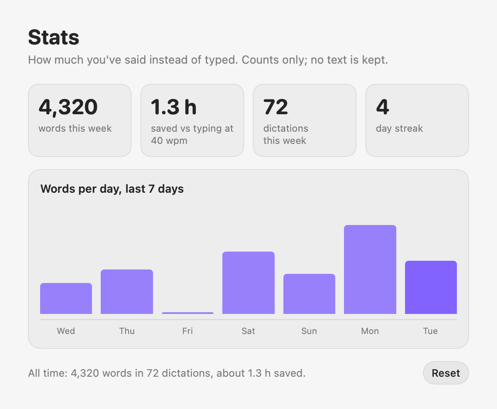
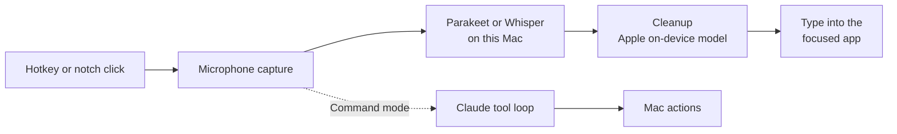

  

<h1 align="center">Utter</h1>

A voice layer for macOS that lives in your MacBook's notch. 
Dictate polished text into any app, or tell your Mac what to do.

  

## What it does

- **Dictation.** Hold a key, talk, let go. Utter transcribes on your Mac (the text is ready about half a second after you let go, at any length), removes filler words and false starts, fixes punctuation, matches the app you're typing in, and types the result at your cursor.
- **Edit by voice.** Say "scratch that" to drop the last phrase, "new paragraph" or "new line" to break, and "make that a list" to turn what you said into bullets. Press ⌘Z right after a dictation to undo it.
- **Fits in.** Utter reads the text around your cursor, so a dictation continues your sentence with the right capital letter and spacing. When you fix a word it got wrong, it offers to remember the spelling.
- **Commands.** Hold another key and say what you want: "open Slack", "remind me at 5 to call Sam", "make this friendlier" (rewrites the selected text), "run the deploy script". Shell commands always wait for you to click **Run**.
- **Private by default.** Speech recognition and dictation cleanup run on your Mac. Nothing is uploaded unless you choose Claude for cleanup or use Command mode.

| | |
|---|---|
|  | Rest the pointer under the camera to open the controls. |
|  | While you talk, the orb and waveform move with your voice. |
|  | After you release the key, Whisper transcribes and the text is polished. |
|  | The text is typed at your cursor. |
|  | Commands that run in Terminal wait for your approval. |

## More screenshots

| | |
|---|---|
|  | **Menu bar panel.** Both modes with their shortcuts, recent dictations (click to copy), mute and settings. |
|  | **Get started.** Four steps: three macOS permissions and the one-time speech model download. |
|  | **Stats.** Words dictated and time saved this week. Only counts are stored. |
|  | **History.** Everything dictated or asked, stored only on this Mac. |
|  | **Floating pill.** Used automatically on Macs without a notch; drag it anywhere. |

 
<em>The orb is three blobs sharing one centre, each a different shape with its edge lit in its own colour. Quiet (top) and while speaking (bottom).</em>

## Controls

| Input | Action |
|---|---|
| Hold **Left ⌃ + Left ⌥** | Dictate; release to insert |
| Double-press **Left ⌃ + Left ⌥** | Hands-free dictation; press again to finish |
| Hold **Right ⌘** | Command mode |
| **Esc** | Cancel |

Both shortcuts can be changed in Settings → Shortcuts. Click the menu bar icon for the Utter panel; right-click it for Settings, Mute and Quit.

## Install

| Minimum | Recommended |
|---|---|
| macOS 14, any Mac (Intel or Apple Silicon), 8 GB memory | Apple Silicon, macOS 26 with Apple Intelligence, 16 GB memory |

The app is about 16 MB. The speech model (NVIDIA Parakeet) is a one-time download of about 500 MB inside the app, and uses about 200 MB of memory. Whisper is optional, for languages beyond Parakeet's 25. Works on every screen size: in the notch on MacBooks that have one, as a floating pill on other Macs. Full requirements: [INSTALL.md](docs/INSTALL.md#requirements).

1. Open `Utter.dmg` and drag **Utter** into **Applications**.
2. Open Utter and follow the **Get started** checklist: Microphone, Speech Recognition and Accessibility permissions, then **Download** the speech model.
3. Hold **Left ⌃ + Left ⌥** in any text field and talk.

Full instructions, including what gets downloaded where and how to uninstall: **[docs/INSTALL.md](docs/INSTALL.md)**.

## How it works

Details: **[docs/ARCHITECTURE.md](docs/ARCHITECTURE.md)**.

## Documentation

| Document | For |
|---|---|
| [INSTALL.md](docs/INSTALL.md) | Installing on a new Mac, Whisper setup, troubleshooting, uninstalling |
| [ARCHITECTURE.md](docs/ARCHITECTURE.md) | Components, data flow, privacy and security |
| [DEVELOPMENT.md](docs/DEVELOPMENT.md) | Building from source, signing, checks, developer tools |
| [DISTRIBUTION.md](docs/DISTRIBUTION.md) | Notarizing, the store, and license keys |
| [ROADMAP.md](docs/ROADMAP.md) | Known gaps and what's next |
| [decisions/](docs/decisions/) | Why things are the way they are |

## License

Utter is paid software with a 14-day free trial. Copyright © 2026 The Utter authors. All rights reserved. The source is published for reference only; see [LICENSE](LICENSE). Third-party components are listed in [THIRD_PARTY_NOTICES.md](THIRD_PARTY_NOTICES.md).
