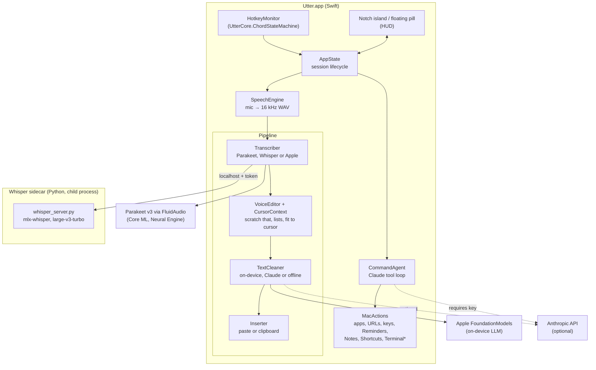

# Architecture

Utter is a menu bar app (Swift, SwiftUI and AppKit). Speech recognition runs inside it (Parakeet on the Neural Engine), or in an optional helper process for Whisper.

## Overview

\* Terminal commands always show the exact command and wait for the user to click **Run**.

## A dictation, step by step

0. **Before listening.** A start chime plays (its sound is cut from the recording), and `CursorContext` reads the text before and after the cursor through Accessibility.
1. **Hotkey.** `HotkeyMonitor` feeds key events into `ChordStateMachine`, which decides press, release, cancel (any other key or modifier) or hands-free lock (double-press).
2. **Capture.** `SpeechEngine` records the microphone as 16 kHz mono WAV. Apple's recognizer runs alongside only if it's the chosen transcriber or the live preview is turned on.
3. **Transcribe.** With Parakeet (the default), the whole recording is transcribed on release, trimmed to where speech ends; it takes about 0.3 s for 20 s of speech. With Whisper, transcription happens while the user talks: every half second, `WhisperTranscriber` asks `PauseChunker` (UtterCore) whether the unsent audio has reached a natural pause, at least 0.3 s of near-silence after 6 s of speech (or the quietest moment after 20 s). If so, that chunk goes to the sidecar in the background, with the personal dictionary and the end of the previous chunk as context. On release only the remainder is sent, so the wait stays around 0.6 s regardless of length. If a chunk fails, the whole recording is transcribed once instead; if Whisper isn't available, Apple's recognizer is used.
4. **Voice edits.** `VoiceEditor` (UtterCore) applies spoken edits: "scratch that" removes the phrase before it, "new paragraph" and "new line" insert breaks, "make that a list" turns sentences into bullets.
5. **Clean.** The chosen `TextCleaner` removes fillers and false starts, fixes punctuation and matches the destination app's style. The on-device cleaner's output is checked by `CleanupGuard`: small models sometimes answer a dictated question instead of cleaning it, and those outputs are discarded in favour of offline cleanup.
6. **Fit and insert.** `ContinuationFormatter` adjusts the first letter, leading space and final full stop to the text around the cursor. `Inserter` pastes at the cursor and restores the clipboard; without Accessibility, it leaves the text on the clipboard.
7. **Afterwards.** The word count goes to `StatsStore`. `CorrectionWatcher` watches the field for 40 seconds; if the user replaces a word Utter typed with a name or a correctly spelled word, the island offers to add it to the dictionary. ⌘Z right after a dictation removes it.

The island keeps one size from listening through "Polishing" to "Inserted N words".

## Components

| Area | Location | Role |
|---|---|---|
| Core logic | `Sources/UtterCore` | Pure Swift with no UI: hotkey rules, pause-aligned chunking, speech detection, voice edits, cursor continuation, correction finding, usage stats, cleanup guard, snippets, notch layout. Checked by `swift run UtterChecks`. |
| Features | `Sources/Utter/Features` | Chimes, cursor context, correction learning, stats storage |
| Session | `AppState.swift` | Phases (idle, listening, processing, done, failed), history, permissions |
| Pipeline | `Sources/Utter/Pipeline` | `Transcriber`, `TextCleaner` and `Inserter` implementations, chosen per session |
| Speech | `SpeechEngine.swift`, `RecognitionStream.swift` | Microphone, WAV capture, Apple recognizer with pause stitching |
| Parakeet | `Pipeline/Parakeet.swift` | Download, load, unload when idle, transcribe (FluidAudio) |
| Whisper | `WhisperSidecar.swift`, `sidecar/whisper_server.py`, `scripts/setup-whisper.sh` | Install, launch, health-check and call the local server |
| On-device cleanup | `LocalModel.swift` | Apple FoundationModels prompt and guard |
| Commands | `CommandAgent.swift`, `MacActions.swift`, `ClaudeClient.swift` | Claude tool-use loop over a fixed set of actions |
| UI | `Sources/Utter/HUD`, `Settings`, `MenuContent.swift`, `Theme.swift` | Notch island, floating pill, liquid orb, settings window, menu |

## Process model and security

- **Two processes.** Utter launches `whisper_server.py` as a child process using its own Python environment. The server exits by itself if Utter goes away.
- **Local only.** The server listens on `127.0.0.1`, on a port the OS picks, and requires a random token generated on each launch (`X-Utter-Token`). Other programs on the Mac can't use it.
- **No arbitrary code from the model.** Command mode can only call the actions in `MacActions`. The one action that runs shell commands shows the exact command and runs it only after the user clicks Run.

## Data and privacy

| Data | Where it goes |
|---|---|
| Audio | Recorded to a temporary WAV, transcribed locally, deleted immediately |
| Transcripts and results | History in `~/Library/Application Support/Utter/history.json` (on this Mac only; cleared automatically after 7 or 30 days if chosen, or kept off entirely) |
| Usage stats | Word, dictation and second counts per day in `stats.json`; no text |
| Diagnostics | `diagnostics.log` (capped at 2 MB, one older file kept): held modifier keys and what they triggered, a count of other key presses every 10 minutes, sleep/wake/lock, permission changes, session steps and microphone format. Never which letters or words were typed, and never dictated text |
| Text around the cursor | Read when dictation starts, used only to fit the new text, never stored or sent |
| Anthropic API key | Login Keychain |
| Text sent to Claude | Only in Command mode, or when Claude is chosen as the cleanup engine |
| Window title | Used as a style hint for cleanup; can be turned off in Settings |

## Extending

- **New transcriber:** implement `Transcriber` and return it from `Transcribers.current()`. `ParakeetTranscriber` is the smallest example.
- **New cleaner:** implement `TextCleaner` and add it to `Cleaners.current(hasAPIKey:)`.
- **New command action:** add a tool definition in `CommandAgent` and its handler in `MacActions`.
