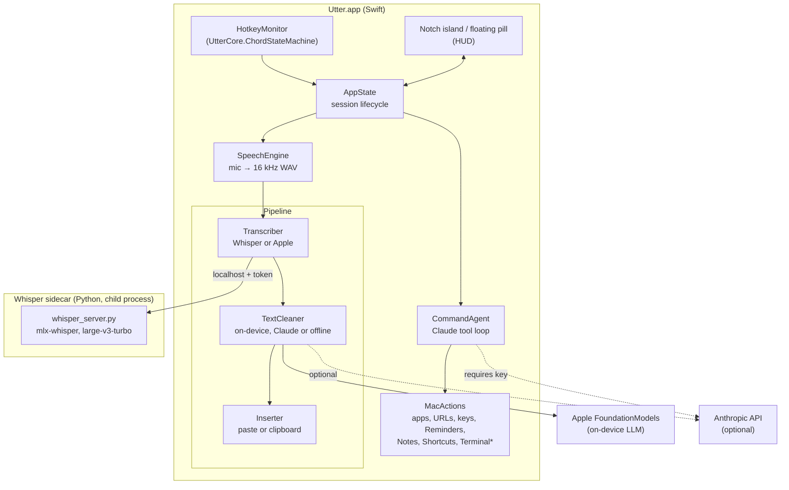

# Architecture

Utter is a menu bar app (Swift, SwiftUI and AppKit) plus one helper process for Whisper.

## Overview

\* Terminal commands always show the exact command and wait for the user to click **Run**.

## A dictation, step by step

1. **Hotkey.** `HotkeyMonitor` feeds key events into `ChordStateMachine`, which decides press, release, cancel (any other key or modifier) or hands-free lock (double-press).
2. **Capture.** `SpeechEngine` records the microphone as 16 kHz mono WAV. Apple's recognizer runs alongside only if it's the chosen transcriber or the live preview is turned on.
3. **Transcribe.** `WhisperTranscriber` sends the WAV path to the sidecar, with personal-dictionary words as a spelling hint. If Whisper isn't available, Apple's recognizer is used.
4. **Clean.** The chosen `TextCleaner` removes fillers and false starts, fixes punctuation and matches the destination app's style. The on-device cleaner's output is checked by `CleanupGuard`: small models sometimes answer a dictated question instead of cleaning it, and those outputs are discarded in favour of offline cleanup.
5. **Insert.** `Inserter` pastes at the cursor and restores the clipboard. Without Accessibility, it leaves the text on the clipboard.

The island keeps one size from listening through "Polishing" to "Inserted N words".

## Components

| Area | Location | Role |
|---|---|---|
| Core logic | `Sources/UtterCore` | Pure Swift with no UI: hotkey rules, pause stitching, cleanup guard, snippets, shortcut parsing. Checked by `swift run UtterChecks`. |
| Session | `AppState.swift` | Phases (idle, listening, processing, done, failed), history, permissions |
| Pipeline | `Sources/Utter/Pipeline` | `Transcriber`, `TextCleaner` and `Inserter` implementations, chosen per session |
| Speech | `SpeechEngine.swift`, `RecognitionStream.swift` | Microphone, WAV capture, Apple recognizer with pause stitching |
| Whisper | `WhisperSidecar.swift`, `sidecar/whisper_server.py`, `scripts/setup-whisper.sh` | Install, launch, health-check and call the local server |
| On-device cleanup | `LocalModel.swift` | Apple FoundationModels prompt and guard |
| Commands | `CommandAgent.swift`, `MacActions.swift`, `ClaudeClient.swift` | Claude tool-use loop over a fixed set of actions |
| UI | `Sources/Utter/HUD`, `Settings`, `MenuContent.swift`, `Theme.swift` | Notch island, floating pill, liquid orb, settings window, menu |

## Process model and security

- **Two processes.** Utter launches `whisper_server.py` as a child process using its own Python environment. The server exits by itself if Utter goes away.
- **Local only.** The server listens on `127.0.0.1`, on a port the OS picks, and requires a random token generated on each launch (`X-Utter-Token`). Other programs on the Mac can't use it.
- **No arbitrary code from the model.** Command mode can only call the actions in `MacActions`. The one action that runs shell commands shows the exact command and runs it only after the user clicks Run.

## Data and privacy

| Data | Where it goes |
|---|---|
| Audio | Recorded to a temporary WAV, transcribed locally, deleted immediately |
| Transcripts and results | History in `~/Library/Application Support/Utter/history.json` (on this Mac only; clearable in Settings) |
| Anthropic API key | Login Keychain |
| Text sent to Claude | Only in Command mode, or when Claude is chosen as the cleanup engine |
| Window title | Used as a style hint for cleanup; can be turned off in Settings |

## Extending

- **New transcriber** (for example WhisperKit inside the app): implement `Transcriber` and return it from `Transcribers.current()`.
- **New cleaner:** implement `TextCleaner` and add it to `Cleaners.current(hasAPIKey:)`.
- **New command action:** add a tool definition in `CommandAgent` and its handler in `MacActions`.
